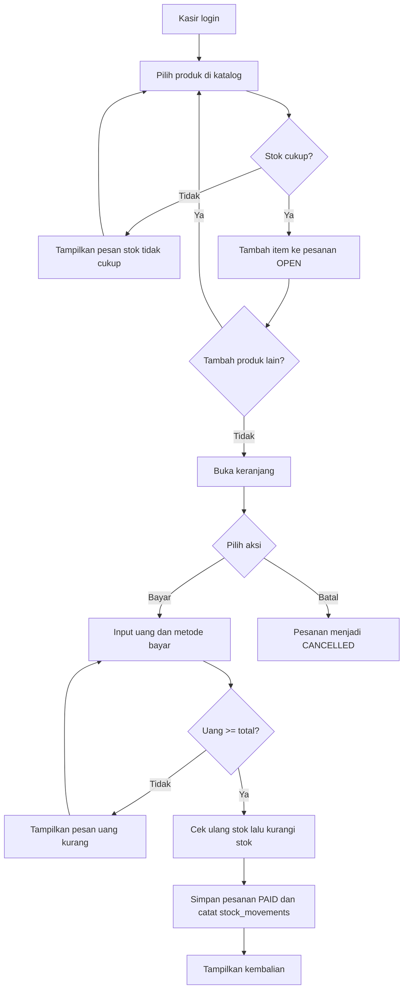
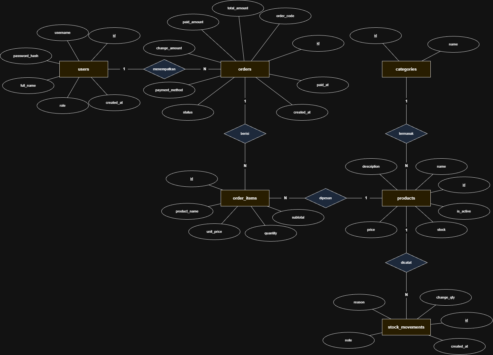

# Roti Bakar Asjad

## 1. Deskripsi Aplikasi

Roti Bakar Asjad adalah aplikasi kasir sederhana untuk toko roti bakar. Kasir menggunakan aplikasi untuk memilih menu, membuat pesanan, menerima pembayaran, dan mencatat transaksi. Stok dikurangi secara otomatis saat transaksi dibayar. Admin mengelola menu, kategori, dan stok, serta memantau riwayat penjualan.

**Tujuan:**
- Mempercepat proses transaksi di kasir.
- Menjaga stok tetap akurat dan dapat ditelusuri.
- Menyimpan riwayat transaksi yang tidak berubah walaupun harga menu berubah.

**Ruang lingkup:**
- Satu outlet dan satu perangkat desktop.
- Tidak ada data pelanggan (customer) terdaftar.
- Metode pembayaran (tunai, QRIS, debit) dicatat.

---

## 2. Pengguna dan Hak Akses

| Peran | Deskripsi | Hak akses |
|---|---|---|
| **Kasir** (`KASIR`) | Melayani pelanggan di kasir | Login, melihat katalog, membuat pesanan, membayar, membatalkan pesanan, melihat riwayat |
| **Admin** (`ADMIN`) | Pemilik atau penanggung jawab toko | Semua hak kasir, ditambah kelola kategori, kelola produk, restok dan penyesuaian stok |

---

## 3. Fungsionalitas

| Modul | Fitur | Deskripsi | Peran |
|---|---|---|---|
| Autentikasi | Login | Masuk dengan username dan password. Sesi aktif selama aplikasi berjalan. | Semua |
| Katalog | Lihat produk | Menampilkan produk aktif beserta harga dan stok. Dapat difilter per kategori. | Semua |
| Pesanan | Tambah item | Memilih produk dan kuantitas. Sistem mengecek stok sebelum item ditambahkan. | Kasir |
| Pesanan | Ubah dan hapus item | Mengubah kuantitas atau menghapus item selama pesanan masih `OPEN`. | Kasir |
| Pesanan | Batalkan pesanan | Membatalkan pesanan `OPEN`. Karena stok belum dikurangi, stok tidak perlu dikembalikan. | Kasir |
| Pembayaran | Bayar | Memasukkan jumlah uang dan metode pembayaran, menghitung kembalian, mengubah status menjadi `PAID`, dan mengurangi stok. | Kasir |
| Riwayat | Lihat riwayat | Daftar transaksi `PAID` dengan filter tanggal dan detail item. | Semua |
| Kategori | Kelola kategori | Tambah, ubah, dan hapus kategori. Kategori yang masih dipakai produk tidak dapat dihapus. | Admin |
| Produk | Kelola produk | Tambah, ubah, dan nonaktifkan produk. Produk tidak dihapus permanen karena bisa sudah tercatat di transaksi. | Admin |
| Stok | Restok dan penyesuaian | Menambah stok (`RESTOCK`) atau mengoreksi stok (`ADJUSTMENT`) dengan catatan. Setiap perubahan tercatat di `stock_movements`. | Admin |
| Pengguna | Kelola akun kasir | Menambah dan menonaktifkan akun kasir. | Admin |
| Laporan | Ringkasan penjualan | Total penjualan per hari dan produk terlaris. | Admin |

---

## 4. Alur Aplikasi

### 4.1 Alur transaksi kasir



### 4.2 Alur admin

1. Admin login, lalu membuka menu **Kelola Produk** atau **Kelola Stok**.
2. Untuk menambah menu: isi nama, kategori, harga, dan stok awal, lalu simpan. Stok awal tercatat sebagai `RESTOCK`.
3. Untuk mengubah menu: pilih baris di tabel, ubah data di form, lalu simpan.
4. Untuk menonaktifkan menu: pilih produk, lalu klik nonaktifkan. Produk tidak tampil di katalog kasir, tetapi riwayat tetap utuh.
5. Untuk restok: pilih produk, isi jumlah dan catatan, lalu simpan. Untuk koreksi stok, gunakan `ADJUSTMENT` dengan jumlah positif atau negatif.

---

## 5. Aturan Bisnis

1. **Harga dan nama dikunci saat item ditambahkan.** Nilai `unit_price` dan `product_name` disalin ke `order_items`. Perubahan harga produk tidak mengubah transaksi yang sudah ada.
2. **Stok dicek dua kali.** Saat item ditambahkan, kuantitas tidak boleh melebihi stok. Saat pembayaran, stok dicek ulang karena bisa saja berubah.
3. **Stok berkurang hanya saat pembayaran.** Pengurangan stok, perubahan status menjadi `PAID`, dan pencatatan `stock_movements` dilakukan dalam **satu transaksi database**. Jika salah satu gagal, semuanya dibatalkan.
4. **Pembayaran valid** jika `paid_amount >= total_amount`. Kembalian dihitung `change_amount = paid_amount - total_amount`. Metode pembayaran wajib diisi.
5. **Produk tidak dihapus permanen.** Produk yang sudah pernah dipesan hanya dinonaktifkan dengan `is_active = 0`.
6. **Kategori yang masih dipakai tidak dapat dihapus** (foreign key `RESTRICT`).
7. **Nomor pesanan** berformat `RBA-YYYYMMDD-NNNN`, dengan `NNNN` sebagai nomor urut harian. Nomor dibuat di layer service.
8. **Uang dan harga** disimpan sebagai `DECIMAL(12,2)` di database.
---

## 6. Rancangan Database

Nama database: `roti_bakar_asjad`

### 6.1 Daftar tabel

| Tabel | Fungsi |
|---|---|
| `users` | Akun kasir dan admin |
| `categories` | Kelompok produk |
| `products` | Menu yang dijual beserta harga dan stok |
| `orders` | Header transaksi (`OPEN`, `PAID`, `CANCELLED`) |
| `order_items` | Detail produk dalam satu pesanan |
| `stock_movements` | Riwayat setiap perubahan stok |

### 6.2 Detail kolom

**`users`**

| Kolom | Tipe | Constraint | Keterangan |
|---|---|---|---|
| id | INT | PK, AUTO_INCREMENT | |
| username | VARCHAR(50) | NOT NULL, UNIQUE | |
| password_hash | VARCHAR(255) | NOT NULL | Hash BCrypt, bukan password asli |
| full_name | VARCHAR(100) | NOT NULL | |
| role | ENUM('ADMIN','KASIR') | NOT NULL, default `KASIR` | |
| created_at | TIMESTAMP | NOT NULL, default now | |

**`categories`**

| Kolom | Tipe | Constraint | Keterangan |
|---|---|---|---|
| id | INT | PK, AUTO_INCREMENT | |
| name | VARCHAR(100) | NOT NULL, UNIQUE | |

**`products`**

| Kolom | Tipe | Constraint | Keterangan |
|---|---|---|---|
| id | INT | PK, AUTO_INCREMENT | |
| category_id | INT | NOT NULL, FK ke `categories.id` | `RESTRICT` saat hapus |
| name | VARCHAR(150) | NOT NULL | |
| description | VARCHAR(500) | NULL | |
| price | DECIMAL(12,2) | NOT NULL, CHECK >= 0 | |
| stock | INT | NOT NULL, default 0, CHECK >= 0 | Stok saat ini |
| is_active | TINYINT(1) | NOT NULL, default 1 | 0 = nonaktif |

**`orders`**

| Kolom | Tipe | Constraint | Keterangan |
|---|---|---|---|
| id | INT | PK, AUTO_INCREMENT | |
| order_code | VARCHAR(30) | NOT NULL, UNIQUE | Contoh `RBA-20261103-0001` |
| user_id | INT | NOT NULL, FK ke `users.id` | Kasir yang memproses |
| total_amount | DECIMAL(12,2) | NOT NULL, default 0 | Jumlah subtotal item |
| paid_amount | DECIMAL(12,2) | NOT NULL, default 0 | Uang yang diterima |
| change_amount | DECIMAL(12,2) | NOT NULL, default 0 | Kembalian |
| payment_method | ENUM('TUNAI','QRIS','DEBIT') | NULL | Wajib saat `PAID` |
| status | ENUM('OPEN','PAID','CANCELLED') | NOT NULL, default `OPEN` | |
| created_at | TIMESTAMP | NOT NULL, default now | |
| paid_at | TIMESTAMP | NULL | Wajib saat `PAID` |

CHECK constraint `chk_orders_paid` memastikan pesanan `PAID` selalu memiliki metode bayar, waktu bayar, dan `paid_amount >= total_amount`.

**`order_items`**

| Kolom | Tipe | Constraint | Keterangan |
|---|---|---|---|
| id | INT | PK, AUTO_INCREMENT | |
| order_id | INT | NOT NULL, FK ke `orders.id` | `CASCADE` saat hapus |
| product_id | INT | NOT NULL, FK ke `products.id` | `RESTRICT` saat hapus |
| product_name | VARCHAR(150) | NOT NULL | Salinan nama saat dipesan |
| unit_price | DECIMAL(12,2) | NOT NULL | Salinan harga saat dipesan |
| quantity | INT | NOT NULL, CHECK > 0 | |
| subtotal | DECIMAL(12,2) | NOT NULL, CHECK = unit_price x quantity | |

Unique key `(order_id, product_id)` memastikan satu produk hanya muncul satu kali per pesanan. Menambah produk yang sama cukup menambah kuantitasnya.

**`stock_movements`**

| Kolom | Tipe | Constraint | Keterangan |
|---|---|---|---|
| id | INT | PK, AUTO_INCREMENT | |
| product_id | INT | NOT NULL, FK ke `products.id` | |
| order_id | INT | NULL, FK ke `orders.id` | Wajib untuk `SALE` |
| change_qty | INT | NOT NULL, CHECK <> 0 | Positif = masuk, negatif = keluar |
| reason | ENUM('RESTOCK','SALE','ADJUSTMENT') | NOT NULL | |
| note | VARCHAR(255) | NULL | Catatan dari admin atau sistem |
| created_at | TIMESTAMP | NOT NULL, default now | |

### 6.3 ERD



---

## 7. Rancangan Class

### 7.1 Struktur package

```
com.github.rotibakarasjad   (nama paket bebas, sesuaikan dengan project Anda)
├── Main.java
├── entity/          representasi tabel database
│   ├── User.java
│   ├── Category.java
│   ├── Product.java
│   ├── Order.java
│   ├── OrderItem.java
│   └── StockMovement.java
├── entity/enums/    tipe data enumerasi
│   ├── Role.java            (ADMIN, KASIR)
│   ├── OrderStatus.java     (OPEN, PAID, CANCELLED)
│   ├── PaymentMethod.java   (TUNAI, QRIS, DEBIT)
│   └── StockReason.java     (RESTOCK, SALE, ADJUSTMENT)
├── model/           data gabungan untuk tampilan tabel
│   ├── OrderItemRow.java
│   └── OrderHistoryRow.java
├── repository/      akses database (SQL)
│   ├── DatabaseUtil.java
│   ├── UserRepository.java
│   ├── CategoryRepository.java
│   ├── ProductRepository.java
│   ├── OrderRepository.java
│   ├── OrderItemRepository.java
│   └── StockMovementRepository.java
├── service/         aturan bisnis dan transaksi
│   ├── AuthService.java
│   ├── CategoryService.java
│   ├── ProductService.java
│   └── OrderService.java
├── exception/
│   └── BusinessException.java
├── util/
│   ├── CurrencyFormatter.java
│   ├── OrderCodeGenerator.java
│   └── Session.java
└── view/            tampilan Swing
    ├── LoginFrame.java
    ├── MainFrame.java          katalog dan pesanan kasir
    ├── CartFrame.java          keranjang dan pembayaran
    ├── OrderHistoryFrame.java  riwayat transaksi
    └── AdminFrame.java         kelola produk, kategori, stok (tab)
```

### 7.2 Isi tiap class

**Entity**

| Class | Isi |
|---|---|
| `User` | Data akun. Hanya menyimpan `passwordHash`, tidak pernah password asli. |
| `Category` | Kelompok produk. |
| `Product` | Menu beserta harga dan stok. Status aktif dikontrol lewat `active`. |
| `Order` | Header transaksi. Menyimpan status dan total pembayaran. |
| `OrderItem` | Baris item dalam pesanan. Menyimpan salinan nama dan harga. |
| `StockMovement` | Catatan perubahan stok untuk audit. |

**Model (data tampilan)**

| Class | Isi |
|---|---|
| `OrderItemRow` | Data item keranjang untuk `CartFrame`: nama produk, harga, kuantitas, subtotal. |
| `OrderHistoryRow` | Data riwayat untuk `OrderHistoryFrame`: kode pesanan, nama kasir, total, bayar, kembalian, waktu. |

**Repository**

| Class | Isi |
|---|---|
| `DatabaseUtil` | Membuat koneksi JDBC. Menyediakan helper untuk transaksi (`commit` dan `rollback`). |
| `UserRepository` | `findByUsername`, `findById`. |
| `CategoryRepository` | CRUD kategori, `countProductsByCategory`. |
| `ProductRepository` | CRUD produk, `findActive`, `findById`, `updateStock`. |
| `OrderRepository` | `findOpenOrderByUser`, `insert`, `updateStatus`, `findPaidBetween`. |
| `OrderItemRepository` | `findByOrder`, `upsert` (tambah atau ubah kuantitas), `delete`. |
| `StockMovementRepository` | `insert`, `findByProduct`. |

Repository hanya berisi SQL. Repository tidak memuat aturan bisnis.

**Service**

| Class | Metode utama | Isi |
|---|---|---|
| `AuthService` | `login(username, password)`, `logout()` | Verifikasi password BCrypt, mengisi `Session`. |
| `CategoryService` | `create`, `update`, `delete` | Menolak hapus kategori yang masih dipakai. |
| `ProductService` | `create`, `update`, `deactivate`, `restock`, `adjustStock` | Validasi input produk. Setiap perubahan stok dicatat di `StockMovement`. |
| `OrderService` | `getOrCreateOpenOrder`, `addItem`, `updateItemQuantity`, `removeItem`, `cancelOrder`, `payOrder`, `getHistory` | Semua aturan transaksi, termasuk pengecekan stok dan transaksi database saat pembayaran. |

**Exception**

| Class | Isi |
|---|---|
| `BusinessException` | Pelanggaran aturan bisnis (stok kurang, uang kurang, pesanan sudah final). Pesannya ditampilkan langsung ke user. |

**Util**

| Class | Isi |
|---|---|
| `CurrencyFormatter` | Format rupiah, misalnya `Rp 15.000`. |
| `OrderCodeGenerator` | Membuat kode `RBA-YYYYMMDD-NNNN`. |
| `Session` | Menyimpan user yang sedang login. |

**View**

| Class | Isi |
|---|---|
| `LoginFrame` | Form login. Membuka `MainFrame` jika berhasil. |
| `MainFrame` | Katalog produk dan pemilihan produk untuk pesanan. Hanya memanggil service, tidak menulis SQL. |
| `CartFrame` | Isi pesanan, pembayaran, dan pembatalan. |
| `OrderHistoryFrame` | Tabel riwayat dengan filter tanggal. |
| `AdminFrame` | Satu frame dengan tab untuk produk, kategori, dan stok. Tombol tampil hanya untuk role `ADMIN`. |

---

## 8. Pengembangan Lanjutan (opsional)

- Cetak struk pembayaran.
- Laporan penjualan harian dan produk terlaris.
- Diskon atau promo per produk.
